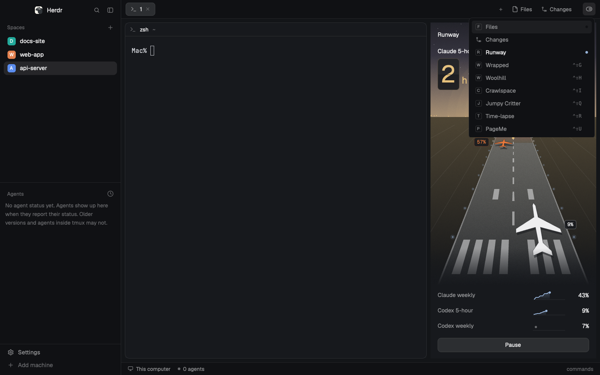

# Mods

A dropdown for Herdr that lists the mods you can open, shows which are open now, and opens or closes one with a click.



A mod for the [Herdr](https://github.com/ogulcancelik/herdr) desktop app. Built for macOS.

Ask your agent to add it from [herdr.dev/mods](https://herdr.dev/gallery/?type=mods), or point it at this repo. It reads [the recipe](RECIPE.md) and every file first. By hand, copy `mods/mod-toggles` into `~/.config/herdr-app/mods` and merge `keys.json` into yours. `ctrl-shift-o` opens it.

To open it from a bar button as a dropdown under the button:

```js
.on_mouse_down("left", (e, cx) => {
  cx.stop_propagation();
  if (shared("mod-toggles.shown") || Date.now() - (Number(shared("mod-toggles.closedAt")) || 0) < 250) return;
  const b = e.bounds, w = 280;
  openOverlay({ mod: "mod-toggles", kind: "popup", frame: "none", width: w,
    height: Number(shared("mod-toggles.height")) || 320,
    at: b ? { x: Math.max(8, b.x + b.width - w), y: b.y + b.height + 6 } : "pointer" });
})
```

`mods/mod-toggles/icon.svg` is there for the button.

It runs `ls` and `herdr-app status` on this machine and makes no network calls.

`node --test` runs the checks.

MIT, see `LICENSE`.
