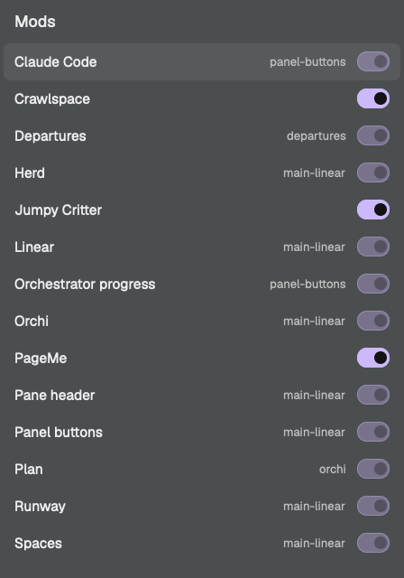

# Mods

An overlay that lists the person's own Herdr mods, one row each, with a switch to turn the mod off or on. `ctrl-shift-o` opens and closes it.

## What you see

- A dialog overlay, 380 by 540, `popover` background, 10px top and bottom padding.
- "Mods" at the top left, 15px semibold, `foreground`, 16px in.
- A scrolling list. Each row is 34px tall, 6px radius, 10px side padding: the mod's `title` from its `mod.json` (else its folder name) at 13px, then on the right a 30 by 18 pill switch.
- On: pill and border `accent`, a 12px `accent_foreground` knob on the right, name in `foreground`.
- Off: pill `raised` with an `input` border, a `muted` knob on the left, name in `muted`.
- Locked rows show, before the switch, the layout or mod that uses them (11px, `dim`), and the switch at 35% opacity.
- The chosen row has a `hover` background.
- If a move or write fails, its message shows under the list in `blocked`, 11px.
- Rows are sorted by title. No other text.

## How it behaves

- Click a row, or Enter or Space on the chosen row, to flip it. Up and Down move the choice. Esc closes.
- Off: the mod's keys come out of `keys.json` (any binding whose action is `mod.open:<name>`, starts with `<name>.`, or is an object for either, and the whole `mod:<name>` section) into `mods/.off/keys.json` under the mod's name, with the key each one sat before. Then `mods/<name>` moves to `mods/.off/<name>`. Herdr doesn't load hidden folders, so the mod is gone from the app and none of its keys are left to press.
- On: the folder moves back, the keys go back where they were (a key taken in the meantime stays with what took it), and `mods/.off` is removed once empty.
- `keys.json` is written in its own indent and with or without its final newline, as it was. Writes use `writeTextFile` with the text just read, so a change made meanwhile isn't overwritten.
- A move never replaces an existing folder; it stops with an error instead.
- Keys can drive it: `mod-toggles.up`, `mod-toggles.down`, `mod-toggles.flip`, and `mod-toggles.flip:<folder>`.

## Built from

- `mods/mod-toggles/mod.json`: `{"place": "none", "title": "Mods", "overlay": {"width": 380, "height": 540}}`.
- `main.js` is the view and the moves. `logic.js` holds the pure parts: `ownMods`, `stripKeys`, `restoreKeys`, `lockedBy`, `parseRefs`, `asBefore`. `refs.sh` lists, for each mod, the files under `layouts/` and `mods/` (hidden folders left out) that name it in quotes or after a colon.
- Listed: folders in `mods/` and `mods/.off/` not in `installed.json` (Herdr's own), not hidden, and not this mod.
- Locked: a mod named by a layout file, or by another mod's code. Reads `installed.json`, each `mod.json`, `keys.json`.
- `herdr` functions: `appHome`, `exec`, `readTextFile`, `writeTextFile`, `props`, `closeOverlay`, `theme`, `nextCommand`.

## Watch out

- There is no Herdr setting or command to disable a mod. Moving the folder is the off switch, so it only works for mods in this home.
- Herdr's own mods are put back on every start, so they are never offered.
- A layout block whose mod is missing breaks that layout, so layout mods stay locked. So do mods another mod opens by name (panes, dialogs).
- The lock scan runs `grep` per mod; on a large home the list takes a moment to fill.
- The JavaScript runtime has no `structuredClone`; copy with JSON.

## Done when

- `herdr-app check ~/.config/herdr-app/mods/mod-toggles` passes and `node --test` passes.
- `ctrl-shift-o` opens the list; no Herdr mod is in it.
- Turning a free mod off moves its folder under `mods/.off`, takes its keys out of `keys.json`, and `herdr-app do mod.open --name <it>` answers "no mod folder".
- Turning it back on leaves `keys.json` byte for byte as it was and `mods/.off` gone.
- A layout mod's switch does nothing.
